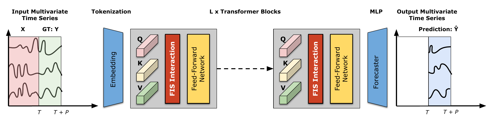
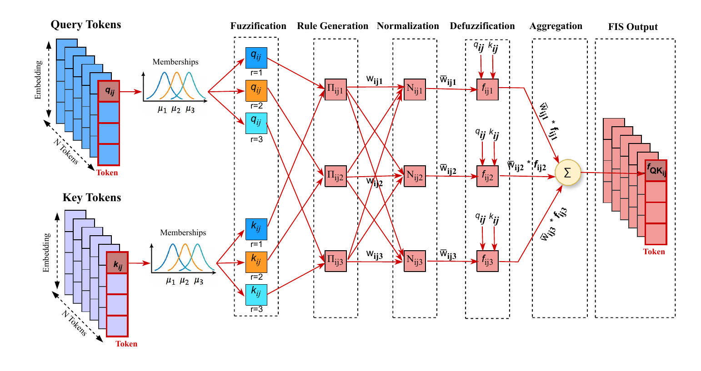
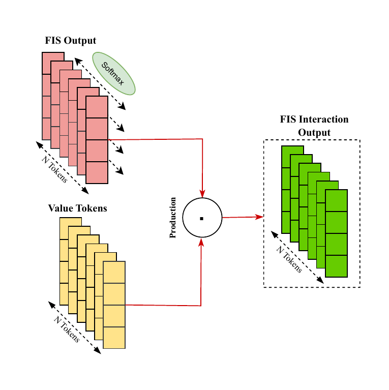
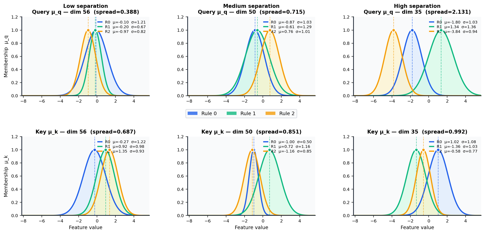
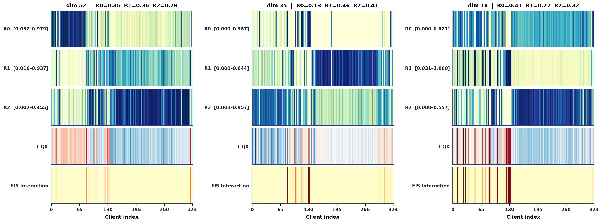

# FISformer: Replacing Self-Attention With a Fuzzy Inference System in Transformer Models for Time Series Forecasting

[](https://doi.org/10.1109/TFUZZ.2026.3690012)
[](LICENSE)

Official PyTorch implementation of the paper

> **FISformer: Replacing Self-Attention With a Fuzzy Inference System in Transformer Models for Time Series Forecasting**
> Bülent Haznedar, Levent Karacan
> *IEEE Transactions on Fuzzy Systems*, vol. 34, no. 8, pp. 2437–2450, Aug. 2026.
> DOI: [10.1109/TFUZZ.2026.3690012](https://doi.org/10.1109/TFUZZ.2026.3690012)

## Introduction

Self-attention measures the relation between tokens with a deterministic dot product, which is limited when it comes to modelling uncertainty and nonlinear dependencies across the dimensions of multivariate time series. **FISformer** replaces this operation with a **FIS Interaction** layer: every query–key pair is processed, separately for each feature dimension, by a **first-order Sugeno fuzzy inference system** with learnable Gaussian membership functions and learnable rule consequents. The resulting *fuzzy interaction map* is normalized with a softmax along the token axis and combined with the values by element-wise multiplication.

<p align="center">

<br><em>Fig. 1. Overall architecture of FISformer.</em>
</p>

### FIS Interaction

<p align="center">

<br><em>Fig. 2. FIS-based token interaction: fuzzification → rule generation → normalization → defuzzification → aggregation.</em>
</p>

For query `q_ij`, key `k_ij` (token *i*, feature dimension *j*) and rule *r* = 1…R:

| Stage | Operation | Paper |
|---|---|---|
| Fuzzification | μ_q(q_ij; r) = exp(−(q_ij − w^Q_jr)² / 2(σ^Q_jr)²), and likewise μ_k for keys | Eq. (5) |
| Rule generation | π_ijr = μ_q(q_ij; r) · μ_k(k_ij; r) (product t-norm) | Eq. (6) |
| Normalization | π̃_ijr = π_ijr / (Σ_s π_ijs + ε) | Eq. (7) |
| Defuzzification | c_ijr = w_r,q q_ij + w_r,k k_ij + b_r,  f_QK(i, j) = Σ_r π̃_ijr c_ijr | Eqs. (9)–(10) |
| FIS interaction | A[:, j] = softmax over tokens of f_QK[:, j],  O = A ⊙ V | Eqs. (11)–(12) |

<p align="center">

<br><em>Fig. 3. FIS interaction output.</em>
</p>

The layer is implemented in [`layers/FIS_Interaction.py`](layers/FIS_Interaction.py) and the model in [`model/FISformer.py`](model/FISformer.py).

## Repository structure

```
FISformer/
├── layers/FIS_Interaction.py   # FIS Interaction layer (the core contribution)
├── model/FISformer.py          # FISformer model (variate tokens + FIS Interaction encoder)
├── model/iTransformer.py       # iTransformer baseline (dot-product attention)
├── scripts/FISformer/          # experiment scripts for every benchmark in the paper
├── scripts/iTransformer/       # baseline scripts with the same backbone settings
├── tests/                      # unit tests for the FIS Interaction layer
├── run.py                      # training / evaluation entry point
└── dataset/                    # put the downloaded datasets here (not tracked by git)
```

The code base builds on the official [iTransformer](https://github.com/thuml/iTransformer) implementation; data loading, embeddings and the training loop follow it so that results are directly comparable.

## Getting started

### 1. Install

Python 3.8+ is required.

```bash
git clone https://github.com/bhaznedar/FISformer.git
cd FISformer
pip install -r requirements.txt
```

`requirements.txt` lists the versions used in the paper (PyTorch 2.0). The code also runs with recent PyTorch releases, on GPU or CPU.

### 2. Download the datasets

The benchmarks are the standard long-term forecasting datasets (ETT, ECL, Exchange, Traffic, Weather, Solar-Energy, PEMS). They can be downloaded from the links provided by the iTransformer authors: [Google Drive](https://drive.google.com/file/d/1l51QsKvQPcqILT3DwfjCgx8Dsg2rpjot/view?usp=drive_link) or [Tsinghua Cloud](https://cloud.tsinghua.edu.cn/f/2ea5ca3d621e4e5ba36a/). Extract them so that the folder looks like this:

```
dataset/
├── ETT-small/        ETTh1.csv  ETTh2.csv  ETTm1.csv  ETTm2.csv
├── electricity/      electricity.csv
├── exchange_rate/    exchange_rate.csv
├── traffic/          traffic.csv
├── weather/          weather.csv
├── Solar/            solar_AL.txt
└── PEMS/             PEMS03.npz  PEMS04.npz  PEMS07.npz  PEMS08.npz
```

### 3. Train and evaluate

Run the scripts from the repository root:

```bash
# FISformer on ETTh1 (all four horizons, learning-rate sweep)
bash ./scripts/FISformer/ETTh1.sh

# A single learning rate with 10 repeated runs (as in Table VIII)
LRS="0.0003" ITR=10 bash ./scripts/FISformer/ETTh1.sh

# iTransformer baseline with the same backbone settings
bash ./scripts/iTransformer/ETTh1.sh

# All benchmarks
bash ./scripts/FISformer/run_all.sh
```

The learning rate is selected from {8e-5, 1e-4, 3e-4, 5e-4, 8e-4, 1e-3} (Sec. IV-B and Fig. 7 of the paper). The scripts run this sweep by default, and the `LRS` environment variable overrides it. Each run appends its MSE/MAE to `result_long_term_forecast.txt`. Metrics are saved under `results/<dataset>/` and checkpoints under `checkpoints/`.

You can also call `run.py` directly:

```bash
python run.py --is_training 1 --model FISformer \
  --root_path ./dataset/ETT-small/ --data_path ETTh1.csv --data ETTh1 --model_id ETTh1_1 \
  --features M --seq_len 96 --pred_len 96 --enc_in 7 --dec_in 7 --c_out 7 \
  --e_layers 2 --d_model 256 --d_ff 256 --learning_rate 0.0003
```

FISformer-specific arguments:

| Argument | Default | Description |
|---|---|---|
| `--model FISformer` | `FISformer` | selects the model |
| `--num_rules` | `3` | number of fuzzy rules / MFs per input (R) |
| `--membershipType` | `gaussian` | membership function type |
| `--save_fis_maps` | off | saves memberships, rule activations and FIS interaction weights (see below) |

### Using the FIS Interaction layer in your own Transformer

`FISInteraction` has the same interface as the inner attention modules of the Time-Series-Library family. It can therefore be wrapped by `AttentionLayer` in place of `FullAttention`:

```python
from layers.SelfAttention_Family import AttentionLayer
from layers.FIS_Interaction import FISInteraction

d_model, n_heads = 512, 8
layer = AttentionLayer(
    FISInteraction(input_dim=d_model // n_heads, num_head=n_heads, num_rules=3),
    d_model, n_heads)

out, _ = layer(x, x, x, attn_mask=None)   # x: (batch, tokens, d_model)
```

## Main results

Average MSE/MAE over the four prediction lengths ({12, 24, 48, 96} for PEMS, {96, 192, 336, 720} for the others), look-back window 96 (Table II of the paper):

| Dataset | FISformer MSE | FISformer MAE | iTransformer MSE | iTransformer MAE |
|---|---|---|---|---|
| ECL | **0.172** | **0.262** | 0.178 | 0.270 |
| ETT (Avg) | **0.375** | **0.395** | 0.383 | 0.399 |
| Exchange | **0.356** | **0.402** | 0.360 | 0.403 |
| Traffic | **0.417** | **0.279** | 0.428 | 0.282 |
| Weather | **0.256** | **0.277** | 0.258 | 0.278 |
| Solar-Energy | **0.232** | **0.261** | 0.233 | 0.262 |
| PEMS (Avg) | 0.122 | 0.219 | **0.119** | **0.218** |

See the paper for per-horizon results, the comparison with Crossformer, FEDformer, Autoformer, Informer and FANTF, the ablation study and the statistical significance tests.

## Interpretability

With `--save_fis_maps`, the tensors of the last test batch and the learned FIS parameters are written for every encoder layer to `results/<dataset>/<setting>/fis_maps/layer<k>/`:

| File | Content |
|---|---|
| `fuzzified_query.npy`, `fuzzified_key.npy` | membership degrees μ_q, μ_k |
| `fuzzy_outputs.npy`, `firing_norm.npy` | rule firing strengths π and normalized π̃ |
| `summed_rule_aggregated.npy` | fuzzy interaction map f_QK |
| `attention_scores_Local.npy` | FIS interaction weights A |
| `similarity_weights.npy`, `similarity_sigma.npy` | query MF centres / spreads |
| `importance_weights.npy`, `importance_sigma.npy` | key MF centres / spreads |
| `rule_weights.npy` | Sugeno rule consequents [w_q, w_k, b] |

These files were used to produce the membership-function and rule-activation figures of the paper:

<p align="center">

<br><em>Learned Gaussian MFs of queries and keys on ECL (Fig. 5).</em>
</p>
<p align="center">

<br><em>Rule activations, fuzzy interaction map and FIS interaction weights on ECL (Fig. 6).</em>
</p>

## Roadmap

- [x] FISformer with Gaussian membership functions (main results of the paper)
- [ ] Triangular and trapezoidal membership functions (Table IX)
- [ ] FIS Interaction integrated into Informer (Table VII)

## Citation

If you find this work useful, please cite:

```bibtex
@article{haznedar2026fisformer,
  title   = {{FISformer}: Replacing Self-Attention With a Fuzzy Inference System in Transformer Models for Time Series Forecasting},
  author  = {Haznedar, B{\"u}lent and Karacan, Levent},
  journal = {IEEE Transactions on Fuzzy Systems},
  volume  = {34},
  number  = {8},
  pages   = {2437--2450},
  year    = {2026},
  doi     = {10.1109/TFUZZ.2026.3690012}
}
```

## Acknowledgement

This repository is built on the official implementation of [iTransformer](https://github.com/thuml/iTransformer) (Liu et al., ICLR 2024). We thank its authors, and the authors of [Time-Series-Library](https://github.com/thuml/Time-Series-Library), [Informer](https://github.com/zhouhaoyi/Informer2020), [Autoformer](https://github.com/thuml/Autoformer), [Reformer](https://github.com/lucidrains/reformer-pytorch), [Flowformer](https://github.com/thuml/Flowformer) and [FlashAttention-PyTorch](https://github.com/shreyansh26/FlashAttention-PyTorch), for releasing their code. The other attention variants in `layers/SelfAttention_Family.py` and the models in `model/` come from these repositories.

## Contact

- Bülent Haznedar — haznedar@gantep.edu.tr
- Levent Karacan — lkaracan@gantep.edu.tr

Department of Computer Engineering, Gaziantep University, Türkiye. Questions and bug reports are welcome as [GitHub issues](https://github.com/bhaznedar/FISformer/issues).
